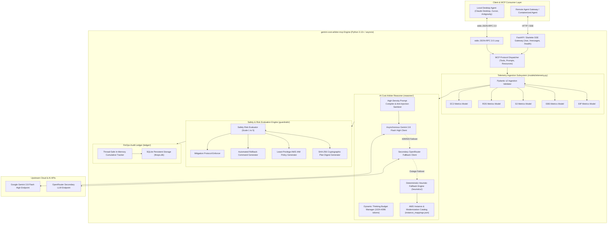

# System Architecture Document: Gemini Autonomous Cloud-Cost Arbiter (`gemini-cost-arbiter-mcp`)

## 1. Architectural Vision & Core Principles

The **Gemini Autonomous Cloud-Cost Arbiter** bridges cloud infrastructure utilization telemetry and autonomous agentic remediation. By coupling **Google Gemini 3.8 Flash High** (configured with dynamic thinking budgets, structured `responseSchema`, and secondary multi-model fallback) with strict Pydantic v2 data contracts, it transforms multi-dimensional telemetry across AWS enterprise infrastructure (**EC2 compute, RDS databases, S3 object storage, detached EBS block storage, and unassociated Elastic IPs**) into validated, risk-governed remediation payloads exposed via the Model Context Protocol (MCP).

```
                      +---------------------------------------+
                      |       MCP Client (Cursor, Claude,     |
                      |       Antigravity, Agent Gateway)     |
                      +-------------------+-------------------+
                                          | JSON-RPC 2.0 (stdio / SSE)
                                          v
+-----------------------------------------------------------------------------------+
|                         gemini-cost-arbiter-mcp Server                            |
|                                                                                   |
|  +------------------------+   +-----------------------+   +--------------------+  |
|  |  Telemetry Ingestion   |   |   Gemini 3.8 Flash    |   |  Safety Guardrails |  |
|  |  & Preprocessing       |-->|   High Reasoner       |-->|  & Risk Engine     |  |
|  |  (EC2,RDS,S3,EBS,EIP)  |   |   (Thinking Budget)   |   |  (Scores 1 to 5)   |  |
|  +------------------------+   +-----------------------+   +--------------------+  |
|                                           |                          |            |
|                                           v                          v            |
|                            +----------------------------------------------+       |
|                            |         Structured Pydantic v2 Egress        |       |
|                            |   (Plan Digest, Rollbacks, & Scoped IAM)     |       |
|                            +----------------------------------------------+       |
+-----------------------------------------------------------------------------------+
                                          |
                                          v
                      +---------------------------------------+
                      |   Downstream Automation / Terraform   |
                      |   / AWS Systems Manager / SRE Review  |
                      +---------------------------------------+
```

### Core Design Tenets
1. **Zero-Human-Preprocessing Ingestion:** Raw cloud telemetry is ingested directly. The engine derives underutilization, IOPS imbalances, and storage tier economics using deterministic Python routines and Gemini 3.8 Flash High reasoning.
2. **Strict Zero-Hallucination Triad:** Constrained decoding at token generation (`responseSchema`), catalog-anchored instance types with standard AWS On-Demand hourly pricing rates (`config/instance_mappings.json`), and deterministic Python cost arithmetic ($(\text{Rate}_{\text{curr}} - \text{Rate}_{\text{tgt}}) \times 730\text{ hrs/mo}$).
3. **Calibrated Safety Risk Scoring (1 to 5) & Quarantine Pattern:** No destructive action can be proposed without an explicit risk rating, mandatory mitigation protocols, automated rollback runbooks, and least-privilege IAM policies. Any action with Risk $\ge 3$ lacking explicit mitigations is strictly quarantined (`quarantined=True`) for human SRE review rather than silently auto-injected with generic templates.
4. **Deterministic IAM & CLI Execution Synthesis:** Execution payloads (`iam_policy`, `aws_cli`, `rollback`) are deterministically synthesized in Python and unconditionally overwrite any LLM-hallucinated permissions, completely stripping wildcard `*` privileges.
5. **Resilient Dual-Path Architecture:** When external LLM APIs are unreachable or rate-limited, the engine falls back seamlessly to deterministic rule-based evaluation, ensuring 100% service uptime for critical SRE workflows.
6. **Authenticated Transports & Timing-Safe Fail-Closed Security:** SSE transport protected via constant-time `hmac.compare_digest()` dual-header / query-param API key authentication; fails closed (HTTP 401 Unauthorized) in production when `MCP_API_KEY` is unconfigured; plans cryptographically signed using HMAC-SHA256 (`PLAN_SIGNING_SECRET`).
7. **FinOps Domain Guardrails:** EC2 memory floor (>65% RAM aborts downsizing to prevent OOM); S3 <128KB object size floor prevents Intelligent-Tiering fee traps; Reserved Instance and Savings Plan commitments are respected ($0 bill savings).
8. **Persistent Audit State:** Stateful FinOps tracking with in-memory performance backed by durable SQLite storage across process restarts.
9. **Dual Transport Flexibility:** Support for both standard I/O (`stdio`) for local IDE/desktop agents and Server-Sent Events (`SSE`) for containerized network gateways.
10. **Turnkey Zero-Cost Packaging:** Multi-stage non-root container (65.5 MB) ready for deployment on AWS Free Tier (`t3.micro`/`t4g.small` or AWS Lambda Serverless Container).
11. **Rigorous Verification:** 100% automated test pass rate across 52 unit, security, heuristic, and protocol tests.

---

## 2. Component Architecture (C4 Container View)



---

## 3. End-to-End Sequence Flows

### 3.1 Primary AI Reasoning Path with Fallback

```mermaid
sequenceDiagram
    autonumber
    actor Client as MCP Client (Agent)
    participant Dispatcher as MCP Dispatcher
    participant Ingestion as Telemetry Ingestion
    participant Reasoner as Gemini 3.8 Flash High
    participant Fallback as Deterministic Heuristic Engine
    participant Guardrails as Risk & IAM Guardrails
    participant Ledger as SQLite Persistent Ledger

    Client->>Dispatcher: tools/call ("generate_remediation_plan", {telemetry, max_risk, dry_run})
    Dispatcher->>Ingestion: Parse & Validate TelemetryBatch
    Ingestion-->>Dispatcher: Validated Batch

    alt Primary AI Path Available
        Dispatcher->>Reasoner: generate_plan(batch) [Thinking Budget: 2048, responseSchema]
        alt Gemini API 200 OK
            Reasoner-->>Dispatcher: Raw Candidate Plan
        else Gemini 429 / 503 Outage
            Dispatcher->>Dispatcher: Retry with Exponential Backoff
            Dispatcher->>Reasoner: Secondary OpenRouter Fallback Client
            alt OpenRouter 200 OK
                Reasoner-->>Dispatcher: Raw Candidate Plan
            else Secondary API Failure
                Dispatcher->>Fallback: evaluate_fleet(batch)
                Fallback-->>Dispatcher: Deterministic Candidate Plan
            end
        end
    else LLM Disabled or Offline
        Dispatcher->>Fallback: evaluate_fleet(batch)
        Fallback-->>Dispatcher: Deterministic Candidate Plan
    end

    Dispatcher->>Guardrails: evaluate_and_enforce(candidate_plan, max_risk, dry_run)
    Guardrails->>Guardrails: Validate Risk 1-5; Quarantine unmitigated Risk >= 3 actions
    Guardrails->>Guardrails: Synthesize Rollbacks & Scoped IAM Policies
    Guardrails->>Guardrails: Cryptographically sign plan with HMAC-SHA256 & Plan Digest
    Guardrails-->>Dispatcher: Enriched RemediationPlan
    Dispatcher->>Ledger: record_batch(batch, plan)
    Ledger->>Ledger: Persist to SQLite
    Dispatcher-->>Client: JSON-RPC Result (RemediationPlan)
```

---

## 4. Dual Transport Topologies

### 4.1 Standard I/O (stdio)
Designed for single-tenant local agents (Claude Desktop, Cursor, Antigravity):
* Reads line-delimited JSON-RPC 2.0 messages from `sys.stdin`.
* Emits responses to `sys.stdout`.
* All application logging is strictly directed to `sys.stderr` to avoid protocol stream contamination.

### 4.2 Server-Sent Events (SSE)
Designed for multi-tenant, containerized, or remote agent gateways:
* Implemented via FastAPI and `sse-starlette`.
* `/sse`: Establishes the downstream event stream and allocates a unique `sessionId`.
* `/messages?sessionId=...`: Receives client JSON-RPC requests via HTTP POST.
* `/health`: Container readiness and liveness check returning `{"status":"healthy","service":"gemini-cost-arbiter-mcp"}`.

---

## 5. Hierarchical PromptOps Architecture

Prompts are decoupled into a structured hierarchy under `prompts/`:
1. **`prompts/master_system_prompt.md`**: Global Tier-0 system prompt defining the SRE Arbiter persona, non-negotiable axioms, calibrated risk scoring, and anti-injection sanitization.
2. **`prompts/modules/`**:
   - `01_ec2_compute_reasoning.md`: EC2 underutilization and Graviton modernization.
   - `02_rds_database_reasoning.md`: Zombie databases and Multi-AZ downsizing.
   - `03_s3_storage_tiering.md`: S3 Intelligent-Tiering and Glacier lifecycle transitions.
   - `04_ebs_eip_reclamation.md`: Orphan EBS volumes and idle Elastic IPs.
   - `05_guardrails_rollback_iam.md`: Automated rollbacks and least-privilege IAM policies.
   - `06_mcp_operational_runbooks.md`: Standard SRE runbooks exposed dynamically via MCP prompts.

---

## 6. Container Packaging & Turnkey Free Tier Deployment Topology

```
+---------------------------------------------------------------------------------------+
|                                AWS FREE TIER DEPLOYMENT TOPOLOGY                      |
+---------------------------------------------------------------------------------------+
|                                                                                       |
|  [OPTION 1: EC2 Free Tier Host]                                                       |
|  AWS EC2 t3.micro / t4g.small (100% Free Tier Eligible)                               |
|  ├── Docker Engine (Multi-stage non-root container, 65.5 MB)                          |
|  │   └── gemini-cost-arbiter run-mcp --transport sse --port 8000                      |
|  └── Volume Mount: /app/data -> SQLite Ledger Persistence (finops.db)                 |
|                                                                                       |
|  [OPTION 2: AWS Lambda Serverless Container]                                          |
|  AWS Lambda Function URL (1,000,000 Free Invocations / Month)                         |
|  └── Container with AWS Lambda Web Adapter (awslabs/aws-lambda-adapter:0.8.4)         |
|      └── FastAPI SSE Server listening on port 8000 (/health, /sse, /messages)         |
|                                                                                       |
+---------------------------------------------------------------------------------------+
```
