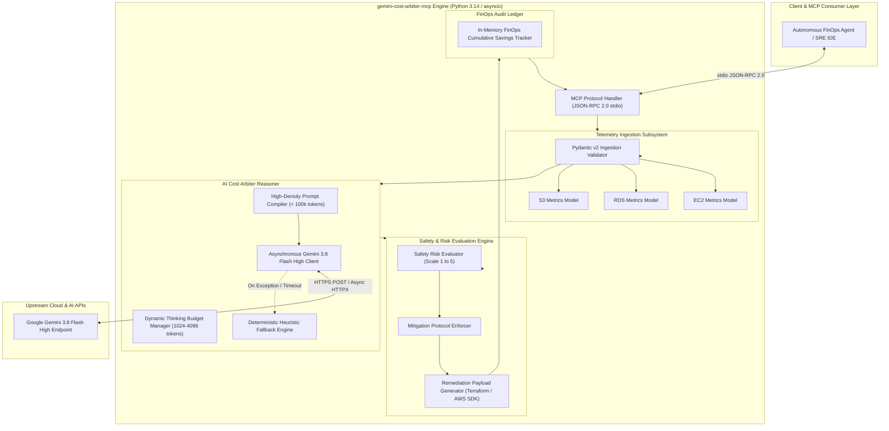
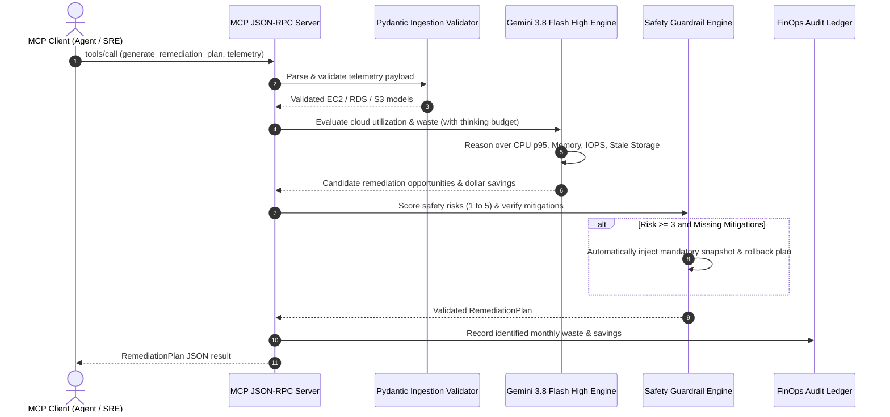

# System Architecture Document: Gemini Autonomous Cloud-Cost Arbiter (`gemini-cost-arbiter-mcp`)

## 1. Architectural Vision & Core Principles

The **Gemini Autonomous Cloud-Cost Arbiter** bridges cloud infrastructure telemetry and autonomous agentic remediation. By coupling **Google Gemini 3.8 Flash High** with strict Pydantic v2 data contracts, it transforms multi-dimensional utilization metrics from AWS services (EC2, RDS, S3) into validated, risk-governed remediation payloads exposed via the Model Context Protocol (MCP).

```
                      +---------------------------------------+
                      |       MCP Client (Cursor, Claude,     |
                      |       Antigravity, Agent Gateway)     |
                      +-------------------+-------------------+
                                          | JSON-RPC 2.0 (stdio)
                                          v
+-----------------------------------------------------------------------------------+
|                         gemini-cost-arbiter-mcp Server                            |
|                                                                                   |
|  +------------------------+   +-----------------------+   +--------------------+  |
|  |  Telemetry Ingestion   |   |   Gemini 3.8 Flash    |   |  Safety Guardrails |  |
|  |  & Preprocessing       |-->|   High Reasoner       |-->|  & Risk Engine     |  |
|  |  (EC2, RDS, S3 Schemas)|   |   (Thinking Budget)   |   |  (Scores 1 to 5)   |  |
|  +------------------------+   +-----------------------+   +--------------------+  |
|                                           |                          |            |
|                                           v                          v            |
|                            +----------------------------------------------+       |
|                            |         Structured Pydantic v2 Egress        |       |
|                            |   (RemediationPlan & Execution Payloads)     |       |
|                            +----------------------------------------------+       |
+-----------------------------------------------------------------------------------+
                                          |
                                          v
                      +---------------------------------------+
                      |   Downstream Automation / Terraform   |
                      |   / AWS Systems Manager / SRE Review  |
                      +---------------------------------------+
```

### Core Design Tenets
1. **Zero-Human-Preprocessing Ingestion:** Raw cloud telemetry is accepted directly. The engine derives underutilization, IOPS imbalances, and cold storage ratios using pure Python mathematical routines and Gemini 3.8 Flash High reasoning.
2. **Schema-Governed Deterministic Egress:** No unstructured markdown or free-form strings are allowed in execution payloads. Every decision conforms to Pydantic v2 models.
3. **Calibrated Safety Risk Scoring (1 to 5):** No destructive action can be proposed without an explicit risk rating and mandatory mitigation protocols.
4. **Resilient Dual-Path Architecture:** When external LLM APIs are unreachable or rate-limited, the engine falls back seamlessly to deterministic rule-based evaluation, ensuring 100% service uptime for critical SRE workflows.
5. **Tight 100k Token Footprint:** Prompts are optimized for high cognitive density without token bloat, ensuring rapid response times and minimal token costs.

---

## 2. Component Architecture (C4 Container View)



---

## 3. Sequence Flow: Telemetry Ingestion to Remediation Payload



---

## 4. Multi-Dimensional Telemetry Ingestion Schema

The system categorizes infrastructure metrics across three primary AWS resource families:

### 4.1 AWS EC2 Virtual Compute
* `resource_id`: e.g., `i-0a8b7c6d5e4f3a2b1`
* `current_instance_type`: e.g., `m5.4xlarge` (16 vCPU, 64 GiB)
* `cpu_utilization_avg_pct`: Continuous rolling 30-day average.
* `cpu_utilization_p95_pct`: 95th percentile metric to detect true workload peaks.
* `memory_utilization_avg_pct`: RAM consumption.
* `network_in_out_mbps`: Bandwidth utilization.
* `monthly_spend_usd`: Current recurring monthly cost.
* `environment`: `production`, `staging`, `development`.

### 4.2 AWS RDS Managed Database
* `resource_id`: e.g., `prod-aurora-cluster-instance-1`
* `current_instance_class`: e.g., `db.r5.2xlarge`
* `cpu_utilization_avg_pct`: Database compute load.
* `memory_free_bytes`: Free RAM for buffer pool.
* `storage_allocated_gb` vs `storage_used_gb`: Allocated vs used disk space.
* `active_connections_avg`: Concurrent client database sessions.
* `multi_az`: High availability topology flag.
* `monthly_spend_usd`: Current monthly database expenditure.

### 4.3 AWS S3 Object Storage
* `resource_id`: e.g., `corporate-analytics-raw-lake`
* `total_storage_gb`: Total data footprint in GB.
* `object_count`: Total number of individual stored objects.
* `current_storage_class`: `STANDARD`, `INTELLIGENT_TIERING`, `GLACIER`, etc.
* `lifecycle_rules_configured`: Boolean indicator of automated expiration/tiering.
* `percentage_infrequently_accessed`: Percent of bytes unread in > 90 days.
* `monthly_spend_usd`: Monthly S3 storage and retrieval costs.

---

## 5. Gemini 3.8 Flash High Reasoning Engine

### 5.1 Dynamic Reasoning Architecture
Google Gemini 3.8 Flash High provides near-instantaneous inference coupled with deep algorithmic reasoning via configurable **Thinking Budgets**. The arbiter uses this capability to perform multi-variable trade-off analysis:
* Distinguishing between batch-scheduled spiky workloads vs chronic idle over-provisioning.
* Evaluating IOPS throttling risks when downsizing EBS volume types.
* Analyzing database read-replica consolidation opportunities.

### 5.2 Context Optimization (< 100k Token Budget)
To ensure low latency and cost predictability, telemetry is compressed into a clean JSON-LD structure before prompting, keeping total context consumption under 4,000 tokens for 50-resource batches.

---

## 6. Safety Guardrails & Risk Scoring (1 to 5)

Every action generated by the engine undergoes deterministic safety classification:

```
[Level 1: Negligible] -> S3 Lifecycle transition / Non-disruptive tiering
[Level 2: Low]        -> Delete detached unattached EBS (>30 days old)
[Level 3: Moderate]   -> Dev/Stage compute right-sizing
[Level 4: High]       -> Production compute right-sizing, RDS class change
[Level 5: Critical]   -> Permanent instance termination or storage drop
```

### Mandatory Mitigations Rules
* For any action where `risk_score >= 3`:
  * `system_mitigations` list cannot be empty.
  * Must specify pre-execution automated snapshot / backup mechanism.
  * Must specify health verification probe URL or CloudWatch alarm target.
  * Must outline an automated rollback procedure.

---

## 7. Model Context Protocol (MCP) Interface

The engine implements standard JSON-RPC 2.0 communication over standard input/output (stdio), exposing:

| Tool Name | Parameters | Returns | Description |
|:---|:---|:---|:---|
| `analyze_infrastructure_waste` | `telemetry_batch: TelemetryBatch` | `WasteAnalysisSummary` | Scans all resources, calculates monthly dollar waste, and identifies top optimization candidates. |
| `generate_remediation_plan` | `telemetry_batch: TelemetryBatch`, `max_acceptable_risk: int` | `RemediationPlan` | Produces an actionable, risk-scored remediation plan complete with execution commands and safety mitigations. |
| `get_finops_audit_summary` | None | `FinOpsAuditSummary` | Returns cumulative financial savings, total resources analyzed, and aggregated statistics. |

---

## 8. Reliability & Deterministic Heuristic Fallback

If upstream Gemini API connectivity experiences network partitioning, HTTP 429 rate limiting, or HTTP 503 outages, the engine activates its internal **Deterministic Heuristic Fallback Engine**:
* Applies deterministic FinOps rules:
  * EC2: If `cpu_utilization_avg_pct < 10%` and `cpu_utilization_p95_pct < 20%` -> propose rightsizing one size down.
  * RDS: If `active_connections_avg == 0` for 30 days -> flag for snapshot and stop.
  * S3: If `percentage_infrequently_accessed > 70%` and `current_storage_class == "STANDARD"` -> propose transition to `INTELLIGENT_TIERING`.
* Produces identical, strictly validated Pydantic v2 `RemediationPlan` outputs, ensuring uninterrupted automated SRE operations.

