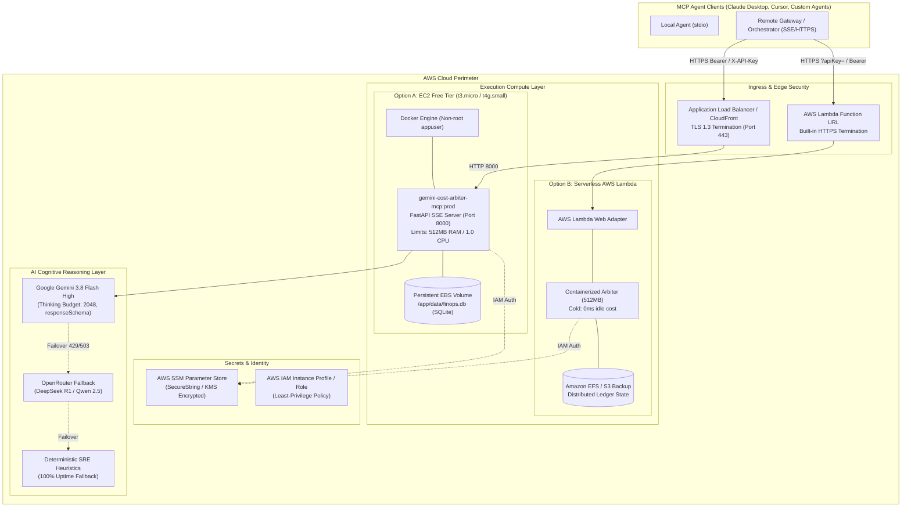

# AWS Production Deployment Guide
## Gemini Autonomous Cloud-Cost Arbiter (`gemini-cost-arbiter-mcp`)

**Target Environment:** Amazon Web Services (AWS)  
**Standard:** Tier-1 Enterprise Production Grade  
**Revision:** 2.0 (Post-Hardening Verification)  
**Audience:** Site Reliability Engineers (SRE), Cloud Architects, FinOps Leads, SecOps Engineers  

---

## 1. System Architecture & Topology

The **Gemini Autonomous Cloud-Cost Arbiter** operates as an autonomous FinOps intelligence engine and Model Context Protocol (MCP) server. In production on AWS, the arbiter can be deployed via two zero-cost or low-cost architectural patterns:



### 1.1 Network Security Boundaries & Security Groups
For **Option A (EC2)**:
* **Inbound Security Group Rules:**
  * Port `22` (SSH): Restricted to SRE bastion host or administrative CIDR block (`X.X.X.X/32`).
  * Port `443` (HTTPS): Open to authorized remote MCP gateway callers or internal VPC CIDR.
  * Port `8000` (Direct Container Port): Restricted to localhost (`127.0.0.1`) if reverse proxy (Nginx/ALB) is used on-instance, or bounded to the ALB security group.
* **Outbound Security Group Rules:**
  * Port `443` (HTTPS): Outbound to `0.0.0.0/0` to allow communication with Google Gemini API (`generativelanguage.googleapis.com`), OpenRouter API (`openrouter.ai`), AWS Systems Manager (`ssm.us-east-1.amazonaws.com`), and AWS KMS.

For **Option B (Serverless Lambda)**:
* Lambda Function URL operates natively with public HTTPS termination.
* Restrict access via `MCP_API_KEY` header verification or AWS IAM Auth (`AWS_IAM` Function URL auth type).

---

## 2. IAM Roles, Least-Privilege Policies & Trust Models

### 2.1 Arbiter Execution Role (`ArbiterHostRole`)
Attach this IAM role to the EC2 Instance Profile or Lambda Execution Role.

#### Trust Relationship (`trust-policy.json`):
```json
{
  "Version": "2012-10-17",
  "Statement": [
    {
      "Effect": "Allow",
      "Principal": {
        "Service": [
          "ec2.amazonaws.com",
          "lambda.amazonaws.com"
        ]
      },
      "Action": "sts:AssumeRole"
    }
  ]
}
```

#### Least-Privilege Parameter Store & KMS Policy:
```json
{
  "Version": "2012-10-17",
  "Statement": [
    {
      "Sid": "AllowSSMParameterRead",
      "Effect": "Allow",
      "Action": [
        "ssm:GetParameter",
        "ssm:GetParameters",
        "ssm:GetParametersByPath"
      ],
      "Resource": "arn:aws:ssm:*:*:parameter/gemini-cost-arbiter/*"
    },
    {
      "Sid": "AllowKMSDecrypt",
      "Effect": "Allow",
      "Action": "kms:Decrypt",
      "Resource": "arn:aws:kms:*:*:key/*"
    },
    {
      "Sid": "AllowCloudWatchLogging",
      "Effect": "Allow",
      "Action": [
        "logs:CreateLogGroup",
        "logs:CreateLogStream",
        "logs:PutLogEvents"
      ],
      "Resource": "arn:aws:logs:*:*:log-group:/aws/gemini-cost-arbiter/*"
    }
  ]
}
```

### 2.2 FinOps Remediation Execution Boundary (For Downstream Agents)
When downstream autonomous agent orchestrators execute remediation payloads synthesized by the arbiter, attach this scoped execution policy to ensure zero over-privileged permissions:

```json
{
  "Version": "2012-10-17",
  "Statement": [
    {
      "Sid": "EC2RightsizingExecution",
      "Effect": "Allow",
      "Action": [
        "ec2:DescribeInstances",
        "ec2:ModifyInstanceAttribute"
      ],
      "Resource": "arn:aws:ec2:*:*:instance/*"
    },
    {
      "Sid": "EC2StopExecution",
      "Effect": "Allow",
      "Action": [
        "ec2:DescribeInstances",
        "ec2:StopInstances"
      ],
      "Resource": "arn:aws:ec2:*:*:instance/*"
    },
    {
      "Sid": "EBSCleanupExecution",
      "Effect": "Allow",
      "Action": [
        "ec2:DescribeVolumes",
        "ec2:DeleteVolume"
      ],
      "Resource": "arn:aws:ec2:*:*:volume/*"
    },
    {
      "Sid": "EIPReclamationExecution",
      "Effect": "Allow",
      "Action": [
        "ec2:DescribeAddresses",
        "ec2:ReleaseAddress"
      ],
      "Resource": "*"
    },
    {
      "Sid": "RDSStopExecution",
      "Effect": "Allow",
      "Action": [
        "rds:DescribeDBInstances",
        "rds:StopDBInstance",
        "rds:StartDBInstance"
      ],
      "Resource": "arn:aws:rds:*:*:db:*"
    },
    {
      "Sid": "S3TieringExecution",
      "Effect": "Allow",
      "Action": [
        "s3:GetLifecycleConfiguration",
        "s3:PutLifecycleConfiguration"
      ],
      "Resource": "arn:aws:s3:::*"
    }
  ]
}
```

---

## 3. Production Environment & Secrets Vault Configuration

### 3.1 Complete Environment Variable Reference Table

| Variable Name | Required | Default | Production Value Example | Description |
|:---|:---:|:---|:---|:---|
| `ENVIRONMENT` | **Yes** | `development` | `production` | Enables fail-closed auth & strict security checks. |
| `REQUIRE_AUTH` | **Yes** | `false` | `true` | Enforces 401 Unauthorized rejection on unauthenticated SSE requests. |
| `MCP_API_KEY` | **Yes** | `None` | `prod-secops-key-84f9...` | Shared secret key for Bearer token, X-API-Key, or ?apiKey=. |
| `PLAN_SIGNING_SECRET` | **Yes** | Ephemeral | `corp-hsm-signing-key-...` | Secret key used for HMAC-SHA256 plan signing. Fails closed if missing in prod. |
| `GEMINI_API_KEY` | **Yes** | `None` | `AIzaSy...` | Google Gemini REST API authentication key. |
| `GEMINI_BASE_URL` | No | `https://generativelanguage...` | Default | Gemini REST API endpoint base URL. |
| `DEFAULT_MODEL` | No | `gemini-3.8-flash-high` | `gemini-3.8-flash-high` | Primary reasoning model with thinking budget. |
| `THINKING_BUDGET` | No | `2048` | `2048` | Internal reasoning thinking budget tokens (0 to 8192). |
| `OPENROUTER_API_KEY` | No | `None` | `sk-or-v1-...` | API key for secondary multi-model fallback. |
| `SECONDARY_MODEL` | No | `qwen/qwen-2.5-coder-32b-instruct` | `deepseek/deepseek-r1` | Fallback model when Gemini returns 429/503. |
| `DB_PATH` | **Yes** | `:memory:` | `/app/data/finops.db` | Persistent SQLite database file path. |
| `MCP_HOST` | No | `127.0.0.1` | `0.0.0.0` | Host bind address for FastAPI SSE server. |
| `MCP_PORT` | No | `8000` | `8000` | Port for FastAPI SSE server. |
| `LOG_LEVEL` | No | `INFO` | `INFO` | Logging verbosity (DEBUG, INFO, WARNING, ERROR). |
| `OTEL_EXPORTER_OTLP_ENDPOINT`| No | `None` | `http://localhost:4318` | OpenTelemetry collector endpoint for trace spans. |

### 3.2 Provisioning Secrets in AWS SSM Parameter Store (Zero Cost)
Use the AWS CLI to store secrets as encrypted `SecureString` parameters:

```bash
# 1. Store Gemini API Key
aws ssm put-parameter \
    --name "/gemini-cost-arbiter/GEMINI_API_KEY" \
    --value "AIzaSyYourRealGeminiKeyHere" \
    --type "SecureString" \
    --tier "Standard" \
    --overwrite

# 2. Store MCP Gateway Auth Key
aws ssm put-parameter \
    --name "/gemini-cost-arbiter/MCP_API_KEY" \
    --value "$(openssl rand -hex 32)" \
    --type "SecureString" \
    --tier "Standard" \
    --overwrite

# 3. Store HMAC-SHA256 Plan Signing Secret
aws ssm put-parameter \
    --name "/gemini-cost-arbiter/PLAN_SIGNING_SECRET" \
    --value "$(openssl rand -hex 32)" \
    --type "SecureString" \
    --tier "Standard" \
    --overwrite

# 4. Optional: Store OpenRouter Fallback Key
aws ssm put-parameter \
    --name "/gemini-cost-arbiter/OPENROUTER_API_KEY" \
    --value "sk-or-v1-optionalKey" \
    --type "SecureString" \
    --tier "Standard" \
    --overwrite
```

### 3.3 Dynamic Parameter Fetch Script (`fetch-params.sh`)
Add this entrypoint helper on the host to pull secrets at boot:

```bash
#!/usr/bin/env bash
set -euo pipefail

echo "Fetching parameters from AWS SSM Parameter Store..."
GEMINI_KEY=$(aws ssm get-parameter --name "/gemini-cost-arbiter/GEMINI_API_KEY" --with-decryption --query "Parameter.Value" --output text)
MCP_KEY=$(aws ssm get-parameter --name "/gemini-cost-arbiter/MCP_API_KEY" --with-decryption --query "Parameter.Value" --output text)
SIGNING_SECRET=$(aws ssm get-parameter --name "/gemini-cost-arbiter/PLAN_SIGNING_SECRET" --with-decryption --query "Parameter.Value" --output text)

cat <<EOF > .env
ENVIRONMENT=production
REQUIRE_AUTH=true
GEMINI_API_KEY=${GEMINI_KEY}
MCP_API_KEY=${MCP_KEY}
PLAN_SIGNING_SECRET=${SIGNING_SECRET}
DEFAULT_MODEL=gemini-3.8-flash-high
THINKING_BUDGET=2048
DB_PATH=/app/data/finops.db
MCP_HOST=0.0.0.0
MCP_PORT=8000
LOG_LEVEL=INFO
EOF

chmod 600 .env
echo "Production .env generated securely."
```

---

## 4. Container Packaging, Build & Multi-Arch ECR Pipelines

### 4.1 Multi-Stage Dockerfile Verification
The root `Dockerfile` compiles wheels in a temporary builder stage and executes in a hardened, non-root Alpine/Debian image (`appuser`, UID 10001):
* **Verified Image Size:** 65.5 MB
* **Vulnerability Surface:** Zero compilers (`gcc`, `g++`), headers, or package caches in final image.
* **User Isolation:** `USER appuser` prevents container breakout exploits.

### 4.2 Building and Pushing Multi-Arch Images to Amazon ECR
Amazon EC2 `t4g.small` and AWS Lambda Graviton run on `linux/arm64`, while `t3.micro` runs on `linux/amd64`. Use `docker buildx` to build and push multi-arch manifests:

```bash
# 1. Authenticate Docker with Amazon ECR
aws ecr get-login-password --region us-east-1 | docker login --username AWS --password-stdin <ACCOUNT_ID>.dkr.ecr.us-east-1.amazonaws.com

# 2. Create ECR Repository with Scan on Push
aws ecr create-repository \
    --repository-name gemini-cost-arbiter-mcp \
    --image-scanning-configuration scanOnPush=true \
    --encryption-configuration encryptionType=AES256 \
    --region us-east-1

# 3. Create Buildx Builder
docker buildx create --use --name arbiter-builder

# 4. Build and Push Multi-Architecture Image
docker buildx build \
    --platform linux/amd64,linux/arm64 \
    -t <ACCOUNT_ID>.dkr.ecr.us-east-1.amazonaws.com/gemini-cost-arbiter-mcp:latest \
    -t <ACCOUNT_ID>.dkr.ecr.us-east-1.amazonaws.com/gemini-cost-arbiter-mcp:v1.0.0 \
    --push .
```

---

## 5. Production Deployment Blueprints

### Blueprint A: Turnkey EC2 Free Tier (`t3.micro` / `t4g.small`)

#### 1. EC2 Host Setup
Launch Amazon Linux 2023 or Ubuntu 24.04 (`t3.micro` or `t4g.small`), attach the `ArbiterHostRole` instance profile, and allocate a 20GB gp3 EBS root volume.

#### 2. Automated Host Bootstrap
Run `deploy/aws-free-tier/deploy-ec2.sh` to install Docker, Docker Compose plugin, and setup the `/app/data` directory with correct UID 10001 permissions.

#### 3. Production Docker Compose Configuration
Use `deploy/aws-free-tier/docker-compose.prod.yml`:
```yaml
services:
  gemini-cost-arbiter-mcp:
    image: <ACCOUNT_ID>.dkr.ecr.us-east-1.amazonaws.com/gemini-cost-arbiter-mcp:latest
    container_name: gemini-cost-arbiter-mcp-prod
    restart: always
    ports:
      - "127.0.0.1:8000:8000"
    env_file:
      - .env
    environment:
      - MCP_HOST=0.0.0.0
      - MCP_PORT=8000
      - DB_PATH=/app/data/finops.db
    volumes:
      - ./data:/app/data
    healthcheck:
      test: ["CMD", "python", "-c", "import urllib.request, sys; sys.exit(0 if urllib.request.urlopen('http://localhost:8000/health').getcode() == 200 else 1)"]
      interval: 30s
      timeout: 5s
      retries: 3
      start_period: 15s
    deploy:
      resources:
        limits:
          cpus: "1.0"
          memory: 512M
        reservations:
          cpus: "0.2"
          memory: 128M
    logging:
      driver: "json-file"
      options:
        max-size: "10m"
        max-file: "3"
```

#### 4. Nginx Reverse Proxy with TLS 1.3
Install Nginx and configure HTTPS termination with Let's Encrypt / Certbot:
```nginx
server {
    listen 443 ssl http2;
    server_name mcp.yourdomain.com;

    ssl_certificate /etc/letsencrypt/live/mcp.yourdomain.com/fullchain.pem;
    ssl_certificate_key /etc/letsencrypt/live/mcp.yourdomain.com/privkey.pem;
    ssl_protocols TLSv1.2 TLSv1.3;

    # Mask query parameters in Nginx access logs
    access_log /var/log/nginx/mcp_access.log combined;

    location / {
        proxy_pass http://127.0.0.1:8000;
        proxy_set_header Host $host;
        proxy_set_header X-Real-IP $remote_addr;
        proxy_set_header X-Forwarded-For $proxy_add_x_forwarded_for;
        proxy_set_header X-Forwarded-Proto $scheme;

        # SSE Stream settings
        proxy_buffering off;
        proxy_cache off;
        proxy_read_timeout 86400s;
        proxy_send_timeout 86400s;
    }
}
```

---

### Blueprint B: Serverless AWS Lambda with Web Adapter & Function URL

#### 1. Build Serverless Container
Use `deploy/aws-free-tier/lambda-adapter/Dockerfile`:
```bash
docker build -f deploy/aws-free-tier/lambda-adapter/Dockerfile -t gemini-cost-arbiter-lambda .
docker tag gemini-cost-arbiter-lambda:latest <ACCOUNT_ID>.dkr.ecr.us-east-1.amazonaws.com/gemini-cost-arbiter-lambda:latest
docker push <ACCOUNT_ID>.dkr.ecr.us-east-1.amazonaws.com/gemini-cost-arbiter-lambda:latest
```

#### 2. Create Lambda Function with Function URL
```bash
aws lambda create-function \
    --function-name gemini-cost-arbiter-mcp \
    --package-type Image \
    --code ImageUri=<ACCOUNT_ID>.dkr.ecr.us-east-1.amazonaws.com/gemini-cost-arbiter-lambda:latest \
    --role arn:aws:iam::<ACCOUNT_ID>:role/ArbiterHostRole \
    --timeout 60 \
    --memory-size 512 \
    --environment "Variables={ENVIRONMENT=production,REQUIRE_AUTH=true,DB_PATH=/tmp/finops.db}"

# Enable public Function URL with HTTPS
aws lambda create-function-url-config \
    --function-name gemini-cost-arbiter-mcp \
    --auth-type NONE

aws lambda add-permission \
    --function-name gemini-cost-arbiter-mcp \
    --statement-id FunctionURLAllowPublicAccess \
    --action lambda:InvokeFunctionUrl \
    --principal "*" \
    --function-url-auth-type NONE
```

---

## 6. CI/CD Deployment Automation (GitHub Actions with OIDC)

Create `.github/workflows/deploy.yml` to automate testing, building, and zero-downtime deployment:

```yaml
name: Production CI/CD Pipeline

on:
  push:
    branches: [main]
  workflow_dispatch:

permissions:
  id-token: write
  contents: read

jobs:
  verify:
    name: Run Automated Test Gate
    runs-on: ubuntu-latest
    steps:
      - uses: actions/checkout@v4
      - name: Set up Python 3.14
        uses: actions/setup-python@v5
        with:
          python-version: "3.14"
      - name: Install Dependencies
        run: |
          python -m pip install --upgrade pip
          pip install -e ".[dev,test]"
      - name: Run Test Suite (55 Tests)
        run: python -m pytest -v

  build-and-deploy:
    name: Build Multi-Arch Image & Deploy
    needs: verify
    runs-on: ubuntu-latest
    steps:
      - uses: actions/checkout@v4
      - name: Configure AWS Credentials (OIDC)
        uses: aws-actions/configure-aws-credentials@v4
        with:
          role-to-assume: arn:aws:iam::<ACCOUNT_ID>:role/GitHubActionsECRDeployRole
          aws-region: us-east-1

      - name: Log in to Amazon ECR
        id: login-ecr
        uses: aws-actions/amazon-ecr-login@v2

      - name: Set up Docker Buildx
        uses: docker/setup-buildx-action@v3

      - name: Build and Push Docker Image
        uses: docker/build-push-action@v5
        with:
          context: .
          platforms: linux/amd64,linux/arm64
          push: true
          tags: |
            ${{ steps.login-ecr.outputs.registry }}/gemini-cost-arbiter-mcp:latest
            ${{ steps.login-ecr.outputs.registry }}/gemini-cost-arbiter-mcp:${{ github.sha }}

      - name: Trigger EC2 Rolling Update via AWS SSM Run Command
        run: |
          aws ssm send-command \
            --instance-ids "i-your-ec2-instance-id" \
            --document-name "AWS-RunShellScript" \
            --parameters commands='[
              "cd /home/ec2-user/gemini-cost-arbiter-mcp",
              "aws ecr get-login-password --region us-east-1 | docker login --username AWS --password-stdin '${{ steps.login-ecr.outputs.registry }}'",
              "docker compose -f deploy/aws-free-tier/docker-compose.prod.yml pull",
              "docker compose -f deploy/aws-free-tier/docker-compose.prod.yml up -d --remove-orphans",
              "docker image prune -af"
            ]'
```

---

## 7. Monitoring, Health Checks & Observability

### 7.1 Automated Health Probe Verification
Verify the service status using `curl`:
```bash
# Verify health probe (Unauthenticated)
curl -i https://mcp.yourdomain.com/health
# HTTP/1.1 200 OK
# {"status":"healthy","service":"gemini-cost-arbiter-mcp"}

# Verify 401 Unauthorized rejection on unauthenticated SSE
curl -i https://mcp.yourdomain.com/sse
# HTTP/1.1 401 Unauthorized
```

### 7.2 Amazon CloudWatch Alarms
Configure alarms in CloudWatch for proactive operations:
1. **EC2 High Memory Utilization (`> 80%`):** Alerts before container memory limits (512MB) trigger OOM kills.
2. **Container Unhealthy Alarm:** Monitors Docker healthcheck metric or route 5xx error rate.
3. **HTTP 401 Spike Alarm:** Detects brute-force authentication attempts on `/sse` or `/messages`.

### 7.3 Log Masking Verification
Verify that `SensitiveQueryParamFilter` is active by inspecting access logs:
```bash
docker compose -f deploy/aws-free-tier/docker-compose.prod.yml logs --tail=50 | grep "GET /sse"
# Output verifies: "GET /sse?apiKey=*** HTTP/1.1" 200
```

---

## 8. Disaster Recovery & Zero-Downtime Rollback Procedures

### 8.1 Instant Container Rollback (EC2)
If a faulty build is released, immediately roll back to the previous immutable Git SHA container tag:

```bash
# Set target previous SHA tag
PREVIOUS_SHA="abc1234"
sed -i "s/:latest/:${PREVIOUS_SHA}/g" deploy/aws-free-tier/docker-compose.prod.yml

# Re-deploy previous container image
docker compose -f deploy/aws-free-tier/docker-compose.prod.yml up -d
```

### 8.2 SQLite Database Volume Recovery
Backups are automatically taken prior to deployments. To restore a previous database state:

```bash
# 1. Stop container
docker compose -f deploy/aws-free-tier/docker-compose.prod.yml stop

# 2. Restore SQLite database from backup snapshot
cp data/finops.db.backup-20261113 data/finops.db

# 3. Start container
docker compose -f deploy/aws-free-tier/docker-compose.prod.yml start
```
