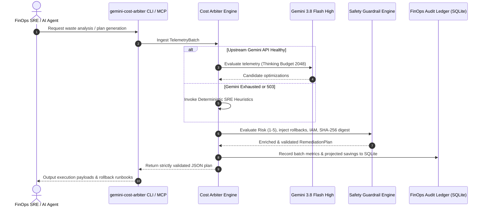

# Product Requirements Document (PRD)

**Product Name:** Gemini Autonomous Cloud-Cost Arbiter (`gemini-cost-arbiter-mcp`)  
**Version:** 1.2.0  
**Status:** Approved / Tier-1 Enterprise Production Grade Hardened  
**Author:** Principal Senior AI Systems Architect & FinOps Product Lead  
**Target Audience:** FinOps Leads, Cloud Platform SREs, AI Agent Engineers  

---

## 1. Product Vision & Executive Summary

The **Gemini Autonomous Cloud-Cost Arbiter (`gemini-cost-arbiter-mcp`)** is an enterprise FinOps intelligence engine and Model Context Protocol (MCP) server. It continuously ingests multi-dimensional cloud utilization telemetry across AWS enterprise infrastructure (**EC2 compute, RDS databases, S3 storage, detached EBS block storage, and unassociated Elastic IPs**), identifies systemic compute, memory, and storage waste, and leverages **Google Gemini 3.8 Flash High** with configurable reasoning thinking budgets to synthesize deterministic, schema-governed remediation execution payloads.

### The Problem
* **Chronic Infrastructure Over-Provisioning:** Cloud engineering teams routinely over-provision compute and database tiers to prevent performance bottlenecks, leading to 30-55% ongoing financial waste.
* **Zombie & Orphaned Resources:** Idle non-production databases, detached EBS storage volumes, unassociated Elastic IPs, and un-tiered S3 standard storage accumulate silently across large multi-account cloud estates.
* **Human Triage Fatigue:** Traditional FinOps tools produce passive dashboard reports requiring manual human triage in spreadsheets, creating substantial delays between waste identification and remediation.
* **Safety Concerns with Autonomous Remediation:** Uncontrolled AI agent actions risk terminating critical production workloads or dropping stateful database clusters without rollback safeguards.

### The Solution
`gemini-cost-arbiter-mcp` bridges cloud telemetry and autonomous agentic execution by:
1. Ingesting raw multi-dimensional utilization metrics with zero human preprocessing.
2. Applying deep algorithmic reasoning via Gemini 3.8 Flash High (and secondary multi-model fallback) alongside a deterministic heuristic rule engine for 100% service uptime.
3. Structurally eliminating hallucinations via Gemini constrained decoding (`responseSchema`), catalog bounds (`instance_mappings.json`), and deterministic Python cost arithmetic.
4. Enforcing a calibrated Safety Risk Scoring Matrix (Scale 1 to 5) that strictly mandates automated snapshots, rollback runbooks, and canary verification for any operation with Risk $\ge 3$.
5. Synthesizing least-privilege AWS IAM policies and SHA-256 cryptographic plan digests.
6. Exposing tools, prompts, and resources over standard Model Context Protocol (MCP) transports (`stdio` and `SSE`).
7. Providing persistent SQLite audit tracking and turnkey zero-cost AWS Free Tier packaging.

---

## 2. User & System Personas

| Persona | Role | Core Objectives | Pain Points Addressed |
|:---|:---|:---|:---|
| **FinOps Infrastructure Lead** | Financial governance and cloud budget management | Quantify monthly dollar waste, project net savings, track cumulative savings across billing cycles. | Replaces manual spreadsheet exports with real-time audit ledger summaries and exact dollar projections. |
| **Cloud Platform / DevOps SRE** | Infrastructure reliability and deployment automation | Ensure zero downtime during rightsizing; receive machine-readable execution commands (AWS CLI, Terraform). | Eliminates guessing on instance downsize limits; guarantees pre-change snapshots and automated rollback payloads. |
| **Autonomous AI Agent (MCP Client)** | Agentic orchestrator (Claude Desktop, Cursor, Antigravity) | Discover FinOps inspection tools, trigger risk-filtered remediation plans, access runbooks, and query audit metrics. | Provides strictly validated Pydantic v2 schemas over JSON-RPC 2.0 without unstructured text hallucinations. |

---

## 3. User Journeys & Workflow Scenarios

---

## 4. Functional Scope & Feature Requirements

### FS-1: Multi-Dimensional Telemetry Ingestion
* **FS-1.1 (EC2 Compute):** Ingest `cpu_utilization_avg_pct`, `cpu_utilization_p95_pct`, `memory_utilization_avg_pct`, `network_in_out_mbps`, `current_instance_type`, and `monthly_spend_usd`. Ensure $p95 \ge avg$ via automated validation.
* **FS-1.2 (RDS Databases):** Ingest `cpu_utilization_avg_pct`, `memory_free_bytes`, `storage_allocated_gb`, `storage_used_gb`, `active_connections_avg`, `multi_az`, and `monthly_spend_usd`.
* **FS-1.3 (S3 Object Storage):** Ingest `total_storage_gb`, `object_count`, `current_storage_class`, `lifecycle_rules_configured`, `percentage_infrequently_accessed`, and `monthly_spend_usd`.
* **FS-1.4 (EBS Block Storage):** Ingest `volume_id`, `volume_size_gb`, `volume_type`, `is_attached`, `days_detached`, `has_snapshot`, and `monthly_spend_usd`.
* **FS-1.5 (Elastic IP Addresses):** Ingest `allocation_id`, `public_ip`, `is_associated`, `days_idle`, and `monthly_spend_usd`.
* **FS-1.6 (Heterogeneous Batch Normalization):** Coerce heterogeneous input shapes into standardized `TelemetryBatch`.

### FS-2: AI Waste Reasoner (Google Gemini 3.8 Flash High)
* **FS-2.1 (Algorithmic Thinking):** Forward configurable reasoning thinking budgets (`thinkingBudget: 1024-4096 tokens`) to Gemini 3.8 Flash High to evaluate trade-offs between workload burstiness and continuous idle state.
* **FS-2.2 (Context Token Budget):** Prune telemetry into high-density JSON structures (< 4,000 tokens for 50-resource batches).
* **FS-2.3 (Constrained Decoding):** Constrain LLM responses directly via `generationConfig.responseSchema = RemediationPlan.model_json_schema()`.
* **FS-2.4 (Hierarchical PromptOps):** System prompts organized into Tier-0 Master Prompt (`prompts/master_system_prompt.md`) and 6 modular cognitive domain prompts (`prompts/modules/`).

### FS-3: Multi-Model Secondary Fallback (OpenRouter)
* **FS-3.1:** Maintain secondary fallback client targeting OpenAI-compatible endpoints (e.g. Qwen 2.5 Coder 32B via OpenRouter).
* **FS-3.2:** Trigger secondary fallback if Gemini API yields HTTP 429, 503, or connection timeouts before switching to deterministic heuristics.

### FS-4: Deterministic SRE Heuristic Engine (High Availability)
* **FS-4.1 (Zero-Outage Resilience):** Guarantee 100% service uptime for SRE automation when external LLM APIs are unreachable.
* **FS-4.2 (EC2 Rightsizing Heuristic & Real Pricing Rates):** If avg CPU $< 10\%$ and p95 CPU $< 25\%$, downsize instance type by one tier from catalog.
  * **Real AWS Pricing Rate Delta:** Projected monthly savings are calculated directly from standard AWS On-Demand hourly rate deltas multiplied by 730 hours/month looked up from `config/instance_mappings.json`, replacing flat 65% multipliers.
  * **Memory Safety Floor:** Abort downsizing if average memory utilization $> 65.0\%$ to prevent Out-Of-Memory (OOM) application crashes.
  * **Pricing Model Commitment Awareness:** If instance is covered by a Reserved Instance (RI) or Savings Plan, set projected savings to \$0.00 with explicit rationale explaining prepaid amortization.
* **FS-4.3 (RDS Idle DB Heuristic):** If average active client connections $== 0.0$, propose stopping database instance with prior automated snapshot and project ~85% spend reduction (or \$0.00 if covered by RI/Savings Plan).
* **FS-4.4 (S3 Cold Storage Heuristic):** If infrequent access percentage $> 50\%$ on `STANDARD` storage without lifecycle policies:
  * **Small-Object Economics Floor:** Disqualify `INTELLIGENT_TIERING` if average object size $< 128\text{ KB}$ to prevent per-object monitoring fee penalties (\$0.0025/1k objects) from exceeding savings.
  * If $\ge 128\text{ KB}$, propose transitioning to `INTELLIGENT_TIERING` and project ~40% spend reduction.
* **FS-4.5 (Detached EBS Volumes):** If volume is detached for $\ge 30$ days, propose `TERMINATE` with pre-delete snapshot and project 100% spend reduction.
* **FS-4.6 (Idle Elastic IPs):** If Elastic IP is unassociated for $\ge 7$ days, propose `RELEASE_ADDRESS` and project 100% spend reduction.

### FS-5: Safety Guardrails & Risk Scoring (Scale 1 to 5)
* **FS-5.1 (Calibration Scale):** Score actions from 1 (Negligible) to 5 (Critical).
* **FS-5.2 (Quarantine Pattern for Missing Mitigations):** Strictly enforce non-empty `system_mitigations` for any action with `safety_risk_score >= 3`. If the reasoner omits mitigations, the action is quarantined (`quarantined=True`, `quarantine_reason=...`) for human review rather than silently auto-injected with generic templates.
* **FS-5.3 (Deterministic Rollback Synthesis):** Automatically generate reversible rollback commands (`rollback` payload) for every proposed action via deterministic Python templates, unconditionally overwriting any LLM-generated strings.
* **FS-5.4 (Least-Privilege IAM Policies & CLI Commands):** Deterministically synthesize scoped AWS IAM statements (`iam_policy`) and precise AWS CLI commands (`aws_cli`) tailored specifically to each action item in Python, stripping any LLM wildcard `*` permissions.
* **FS-5.5 (Cryptographic Plan Digest & HMAC Signing):** Compute both SHA-256 plan digest and HMAC-SHA256 signature (`plan_signature`) using server secret `PLAN_SIGNING_SECRET` to prevent tampering.
* **FS-5.6 (Dry-Run Simulation Mode):** Support `--dry-run` flag in CLI and MCP tool calls to validate execution payloads in simulation.

### FS-6: Model Context Protocol (MCP) Interface
* **FS-6.1 (Protocol Compliance):** Implement JSON-RPC 2.0 matching MCP Protocol Version `2024-11-05`.
* **FS-6.2 (Tools Catalog):** Expose `analyze_infrastructure_waste`, `generate_remediation_plan`, and `get_finops_audit_summary`.
* **FS-6.3 (Prompts Catalog):** Expose `finops_waste_audit_runbook` and `remediation_rollback_procedure`.
* **FS-6.4 (Resources Catalog):** Expose `finops://audit/ledger`, `finops://policies/risk-matrix`, and `finops://config/instance-mappings`.
* **FS-6.5 (Dual Transports):** Provide standard input/output (`stdio`) for local agent execution and FastAPI Server-Sent Events (`SSE`) for containerized gateways.
* **FS-6.6 (Transport Authentication & Fail-Closed Protection):** Protect `/sse` and `/messages` via constant-time `hmac.compare_digest()` authentication middleware across Bearer tokens, `X-API-Key`, and `?apiKey=` query params. In production mode (`ENVIRONMENT=production` or `REQUIRE_AUTH=true`), fail closed (HTTP 401 Unauthorized) when `MCP_API_KEY` is unconfigured, while keeping the `/health` probe unauthenticated.

### FS-7: Stateful FinOps Audit Ledger & SQLite Persistence
* **FS-7.1:** Track cumulative metrics across active execution batches.
* **FS-7.2:** Support ledger state reset and JSON export for auditing compliance.
* **FS-7.3:** Support persistent storage via `--db-path`, allowing the ledger state to survive application restarts using SQLite.

### FS-8: Command Line Interface (CLI)
* **FS-8.1:** Standalone console script `gemini-cost-arbiter`.
* **FS-8.2:** Subcommands: `run-mcp`, `analyze`, `plan` (with `--dry-run`), `audit` (with `--db-path`), and `--version`.

### FS-9: Packaging & Turnkey AWS Free Tier Blueprints
* **FS-9.1 (Multi-Stage Docker Packaging):** Multi-stage non-root container image (`gemini-cost-arbiter-mcp:latest`) verified at 65.5 MB.
* **FS-9.2 (EC2 Free Tier Blueprint):** Turnkey shell script (`deploy-ec2.sh`) and memory-capped production compose (`docker-compose.prod.yml`) for `t3.micro` / `t4g.small`.
* **FS-9.3 (Lambda Serverless Container Blueprint):** Serverless container Dockerfile with AWS Lambda Web Adapter for Function URL hosting.

---

## 5. Non-Functional Requirements (NFR)

| ID | Category | Requirement Specification |
|:---|:---|:---|
| **NFR-1** | **Performance & Latency** | Heuristic evaluation latency $< 500\text{ ms}$ for 100 resources. Total AI reasoning turnaround $< 5.0\text{ s}$ under normal network latency. |
| **NFR-2** | **Memory & Footprint** | Engine memory consumption $\le 128\text{ MB}$ RSS in idle stdio mode; capped at $512\text{ MB}$ under peak containerized processing. |
| **NFR-3** | **Availability & Resilience** | 100% evaluation availability guaranteed by dual-engine fallback. Zero unhandled fatal exceptions on upstream API failures. |
| **NFR-4** | **Security & Isolation** | No credentials committed to version control. Non-root container user (`appuser`, UID 10001). Sanitization against regex prompt injection. |
| **NFR-5** | **Type Safety & Contracts** | 100% type-annotated Python codebase adhering to Pydantic v2 strict models. |
| **NFR-6** | **Compatibility** | Python 3.13 and Python 3.14 operational compatibility across Linux, macOS, and Windows. |

---

## 6. Success Metrics & Key Performance Indicators (KPIs)

1. **Waste Detection Efficacy:** Detect $\ge 95\%$ of chronically underutilized compute, idle databases, detached volumes, and idle IPs.
2. **Safety Compliance Rate:** $100\%$ compliance with mandatory mitigation rules (zero actions with Risk $\ge 3$ lacking snapshots or rollbacks).
3. **Structured Egress Reliability:** $100\%$ deterministic Pydantic schema validation success on AI outputs.
4. **Test Pass Rate:** $100\%$ automated test pass rate across 52+ tests.
5. **Container Footprint:** Production container image content size $\le 100\text{ MB}$ (verified at 65.5 MB).
